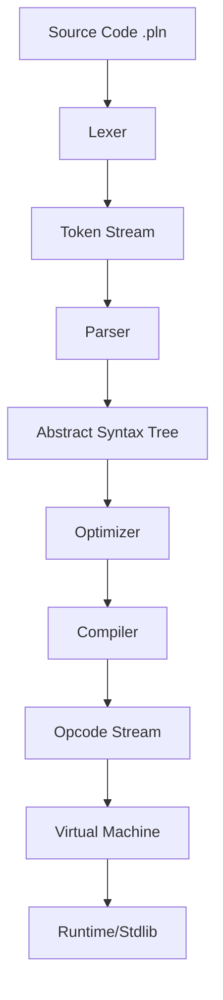

# Pleno Architecture

This document describes the high-level architecture of the Pleno programming language.

## 🏗️ System Overview

Pleno is a register-based virtual machine with a multi-stage compilation pipeline. It is designed for safety, performance, and modern language features like async/await and true encapsulation.

## 1. Compilation Pipeline

### Lexical Analysis (`pleno-lexer`)

The lexer converts raw UTF-8 source code into a stream of `Token`s. It handles:

- **String Interpolation**: Complex expressions within `${}` inside strings.
- **Comments**: Tracking line, block, and documentation comments.
- **Spans**: Recording start and end offsets for diagnostics.

### Parsing (`pleno-parser`)

A hand-written recursive descent parser that transforms tokens into an **AST**.

- **Gradual Typing**: Supports optional type annotations and union types.
- **Modern Syntax**: Implements classes, interfaces, match expressions, and async syntax.

### Optimization (`pleno-optimizer`)

Before compiling, the AST goes through four passes, in this order (`pleno_optimizer::optimize`):

- **Inlining** of `@inline` functions, where the call behaves like the inlined body.
- **Constant Folding**: Pre-calculates constant expressions to reduce runtime overhead.
- **Loop Unrolling** of small loops with constant bounds, within a size budget.
- **DCE (Dead Code Elimination)**: Removes unused declarations and unreachable statements.

### Compilation (`pleno-compiler`)

The compiler transforms the AST into a `Chunk` of bytecode instructions.

- **Register Allocation**: Maps variables to local registers.
- **Closure Analysis**: Identifies captured variables and generates `Opcode::Capture` instructions.
- **Static Checks**: `pleno check` and the language server run the checks in `pleno_compiler::check` (undefined names, argument counts, type mismatches) without running the program.

## 2. Virtual Machine (`pleno-vm`)

Pleno uses a **register-based** stack machine. Unlike stack machines that push/pop every operand (like JVM), Pleno typically operates on fixed register indices within a call frame.

### Instruction Format

Each `Instruction` is a packed 32-bit word:

- **Opcode** (8 bits): The operational command.
- **A** (8 bits): Usually the destination register or primary operand.
- **B** (8 bits): Primary source register or constant index.
- **C** (8 bits): Secondary source register or extra flag.

### Call Stack

Each function call pushes a `CallFrame`:

- **Function Index**: Index into the current chunk's function list.
- **Return Address**: Instruction pointer to resume after return.
- **Base Register**: Offset into the global register stack where this frame starts.
- **Closure State**: If the function is a closure, it holds the captured variables.

### Concurrency Model

Pleno implements cooperative multitasking via an internal **Event Loop**.

- **Promises**: First-class objects representing asynchronous results.
- **AsyncTask**: Suspended VM states that are resumed when their promise is resolved (e.g., IO completion, Mutex unlock).
- **Spawn**: Spawns a new task in the event loop, allowing concurrently executing code.

## 3. Value System (`pleno-value`)

### Value Representation

The `Value` enum is the heart of the system. It uses `Rc` (Reference Counting) or `GcRc` (Garbage Collected Reference Counting) for complex types:

- **Primitives**: `Int` (i64), `Float` (f64), `Bool`, `Char`, `Null`.
- **Heap Types**: `String`, `Array`, `Map`, `Object`, `Function`.
- **Special**: `Promise`, `Cell` (for mutable captures), `BoundMethod`.

### Encapsulation

Pleno enforces true encapsulation at the VM level.

- **Visibility**: `private`, `protected`, `public`, and `internal` modifiers.
- **Access Control**: The VM checks the current `CallFrame`'s class and module against the target property's visibility before allowing access.

### Generics & Variance

Pleno supports generic types with variance annotations.

- **Covariance (`out`)**: Allows a type to be replaced by its subtype (e.g., `List<out Animal>` can accept `List<Dog>`).
- **Contravariance (`in`)**: Allows a type to be replaced by its supertype (e.g., `Comparable<in Dog>` can accept `Comparable<Animal>`).
- **Invariance (default)**: Types must match exactly.
- **VM Verification**: The VM uses `GenericParamMetadata` in bytecode to verify variance during type checks and assignments.

## 4. Garbage Collection (`pleno-value/src/gc.rs`)

Pleno uses a hybrid memory management strategy:

1. **Reference Counting**: Immediate cleanup for most objects.
2. **Cycle Detection**: A mark-and-sweep collector that periodically clears cyclic references which `Rc` cannot handle.

## 5. Standard Library & Native Interface

Pleno bridges to Rust via **Native Functions**. The `pleno-stdlib` crate provides:

- **IO**: File system and terminal operations.
- **Net**: HTTP client and server capabilities.
- **Concurrency**: `Mutex` and `Channel` primitives.
- **Time**: High-precision timers and DateTime utilities.

## 6. Debugging Protocol (`pleno-dap`)

Pleno supports the **Debug Adapter Protocol (DAP)**, enabling IDEs like VS Code to debug Pleno programs.

### Debug Execution

The VM can run in `debug` mode, which:

- Checks for breakpoints before each instruction.
- Supports `step_over`, `step_into`, and `step_out` by tracking stack depth and instruction pointers.
- Allows pausing upon exceptions or user-defined data breakpoints.

### State Inspection

- **Variables**: Deep inspection of `Array`, `Map`, and `Object` types via recursive ID-based variable references managed by `VariableTracker`.
- **Evaluation**: A simplified VM-level expression evaluator that supports property access and indexing during a pause.
- **Call Stack**: Full stack trace visibility with source mapping and function name resolution.

---

For more details on specific components, see the developer guide in [README.dev.md](README.dev.md).
