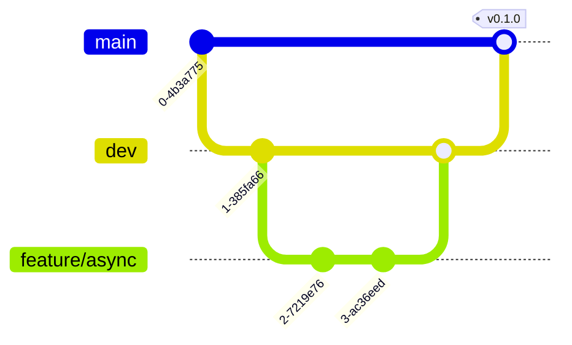

# Pleno Developer Guide

Welcome to the Pleno internal development guide. This document is intended for maintainers and contributors working on the core language implementation.

## 📖 Navigation

- **[Architecture Deep Dive](ARCHITECTURE.md)**: Detailed technical overview of VM and Compiler internals.
- **[Language Specification](specs.md)**: The authoritative reference for Pleno syntax and semantics.
- **[Contributing Guidelines](CONTRIBUTING.md)**: How to submit your changes.

---

## 🚀 Getting Started

### Prerequisites

- **Rust 1.75+**: We use modern features like `let_chains` where available (via feature flags).
- **Make**: Standard build tool.
- **Python 3**: Used for infrastructure scripts and benchmarks.

### Local Setup

```bash
# Clone the repo
git clone https://github.com/otabekoff/pleno.git
cd pleno

# Initial setup (installs hooks and tools)
make setup

# Build everything
make build
```

---

## 🏗️ Project Breakdown

Pleno is a workspace of modular crates:

| Crate               | Purpose                                       |
| ------------------- | --------------------------------------------- |
| `pleno-cli`         | The entry point (`pleno` command).            |
| `pleno-ast`         | Shared AST nodes and source span utilities.   |
| `pleno-lexer`       | Lexical scanner (regex-free for performance). |
| `pleno-parser`      | Syntax analyzer (Recursive Descent).          |
| `pleno-compiler`    | Bytecode generation and basic optimizations.  |
| `pleno-bytecode`    | Instruction definitions and binary format.    |
| `pleno-vm`          | Core execution engine (Register-based).       |
| `pleno-value`       | Core data types and object system internals.  |
| `pleno-stdlib`      | Standard library implemented in Rust.         |
| `pleno-diagnostics` | Pretty-printing errors and spans.             |

---

## 🛠️ Development Workflow

### Useful Make Targets

The `Makefile` in the root is the preferred way to run common tasks:

```bash
make build          # Build in debug mode
make release        # Build in release mode (for benchmarks)
make test           # Run all unit and integration tests
make lint           # Run clippy and format checks
make check          # Full hygiene check (format + lint + test)
make clean          # Remove build artifacts and logs
```

### Compiler/VM Debugging

Developing a language requires deep visibility into internal state. Use these flags:

#### 1. Trace Instruction Execution

```bash
# See every instruction the VM executes
RUST_LOG=pleno_vm=trace pleno run my_script.pln
```

#### 2. Inspect Bytecode

```bash
# Compile to human-readable bytecode dump
pleno compile --dump-bytecode my_script.pln
```

#### 3. AST Inspection

```bash
# Print the AST as a JSON or pretty-formatted tree
pleno debug-ast my_script.pln
```

##### 🛠️ Troubleshooting & Fixes

#### CI Failures

If CI fails on a PR:

1. **Check the logs**: Click on the "Details" link of the failed check.
2. **Reproduce locally**: Run `make check` locally. Most CI failures are due to formatting or clippy warnings which `make check` catches.
3. **Rust Version**: Ensure you are using the version specified in `rust-toolchain.toml` (1.75+).

#### Common Issues

- **Parser errors**: Check lexer output first using `pleno debug-ast --lexer-only`.
- **VM errors**: Enable `RUST_BACKTRACE=1` for detailed Rust-level traces.
- **Flaky Tests**: If a test fails intermittently (especially concurrency tests), it might be a race condition. Use `cargo test -- --worker-threads=1` to see if it stabilizes.

---

## 🧪 Advanced Testing

### Source Tests

Most language features should be tested using "Source Tests" in `tests/sources_tests/`. These are `.pln` files that the VM runs, comparing the output against a `.expected` file or internal assertions.

### Benchmark Regression

Before major VM changes, run the regression suite:

```bash
python3 bench/run_bench.py --baseline
# ... make changes ...
python3 bench/run_bench.py --compare
```

---

## 💡 Troubleshooting

### "Unterminated string literal at start of file"

This usually indicates a Lexer failure. Check if there are invisible BOM characters or encoding issues in the test file.

### "Instruction pointer out of bounds"

The compiler generated a jump to an invalid index. This is a compiler bug. Use `pleno compile --dump-bytecode` to find the invalid jump target.

### "Stack Overflow (Recursive Calls)"

Pleno VM has a default recursion limit of 1000 frames. If you hit this legitimately, you might need to use `loop` or increase the limit in `VMConfig`.

9. Open a Pull Request

### 🌿 Branch Management

We maintain a strict branch hierarchy:

- `main`: The "Source of Truth". Only contains stable, tested, and released code. Direct commits are forbidden; always use PRs.
- `dev`: The integration branch. New features are merged here first for testing before moving to `main`.
- `feature/*`: Short-lived branches for new functionality.
- `fix/*`: Branches for bug fixes.



### 📝 Commit Message Convention

We follow [Conventional Commits](https://www.conventionalcommits.org/):

```
<type>[optional scope]: <description>

[optional body]

[optional footer(s)]
```

**Types:**

- `feat`: A new feature
- `fix`: A bug fix
- `docs`: Documentation only changes
- `style`: Changes that do not affect the meaning of the code (white-space, formatting, etc.)
- `refactor`: A code change that neither fixes a bug nor adds a feature
- `perf`: A code change that improves performance
- `test`: Adding missing tests or correcting existing tests
- `chore`: Changes to the build process or auxiliary tools and libraries

We use `husky` and `lint-staged` to enforce these conventions and run formatting/linting automatically on every commit.

### 🏷️ Tag Management (Re-releasing)

If a release fails (e.g., CI error during build) and you need to re-trigger the same version:

1. **Delete the local and remote tag:**
   ```bash
   git tag -d v0.1.0
   git push origin :refs/tags/v0.1.0
   ```
2. **Commit your fixes** to `main`.
3. **Re-tag and push:**
   ```bash
   git tag v0.1.0
   git push origin v0.1.0
   ```

---

## 📦 Release Procedure

We use **Semantic Versioning (SemVer) 2.0.0** for both the language and its tooling.

### 🔢 Version Scheme

- **MAJOR** (`x.0.0`): Breaking changes to the core language syntax, removed features, or major architectural shifts in the VM that break backward compatibility.
- **MINOR** (`1.x.0`): New language features (new keywords, decorators, stdlib modules) that are backward compatible.
- **PATCH** (`1.0.x`): Bug fixes, internal performance optimizations, and documentation updates.

### 📜 Stability Guarantee

- **Pre-v0.1.0**: The language is in active development. Minor versions may contain breaking changes.
- **Post-v0.1.0**: We guarantee backward compatibility for all minor and patch releases.

1. Update version in root `Cargo.toml`.
2. Run `make check` to ensure perfection.
3. Update `CHANGELOG.md`.
4. Create a signed tag: `git tag -s v0.x.x -m "Release v0.x.x"`.
5. Push: `git push origin main --tags`.

The CI pipeline will automatically build binaries for Linux, macOS (Intel/M1), and Windows.

---

**Happy Hacking! 🛠️**
