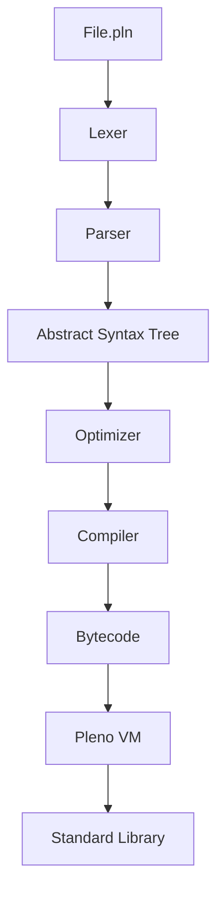

# Pleno Programming Language

[](https://github.com/otabekoff/pleno/actions/workflows/ci.yml)
[](https://opensource.org/licenses/MIT)
[](https://github.com/otabekoff/pleno/releases)

Pleno is a modern, high-performance programming language designed for clarity, safety, and expressiveness. It combines the ease of use of dynamic languages with the robustness of modern systems programming features.

## ✨ Key Features

- **🚀 Performance**: Low-level VM implementation in Rust with optimized opcodes.
- **🛡️ Safety**: Optional static typing, deep immutability, and safe navigation.
- **🧵 Concurrency**: Built-in support for `async/await`, `Mutex`, and `Channel` primitives.
- **📦 Expressive Syntax**: Pattern matching, string interpolation, and powerful closures.
- **🧩 Modern OOP**: True encapsulation with private/protected fields and interfaces.

## 🏗️ Architecture



## 📦 Workspace Layout

| Crate | What it does |
| --- | --- |
| `crates/pleno-cli` | The `pleno` and `plm` commands |
| `crates/pleno-lexer` | Turns source text into tokens |
| `crates/pleno-parser` | Recursive descent parser that builds the AST |
| `crates/pleno-ast` | AST nodes, spans and a visitor |
| `crates/pleno-optimizer` | AST passes: constant folding, dead code, inlining, loop unrolling |
| `crates/pleno-compiler` | Compiles the AST to bytecode; the static checks of `pleno check` |
| `crates/pleno-bytecode` | Instructions, chunks and the `.plc` file format |
| `crates/pleno-vm` | The register-based VM, its event loop and the modules built into it |
| `crates/pleno-value` | Values, NaN boxing and the garbage collector |
| `crates/pleno-stdlib` | Standard library modules such as `std:json`, `std:http` and `std:db` |
| `crates/pleno-package` | Packages (Git repositories), `pleno.toml` and `pleno.lock` |
| `crates/pleno-formatter` | `pleno format` |
| `crates/pleno-linter` | `pleno lint` |
| `crates/pleno-lsp` | The language server, `pleno-lsp` |
| `crates/pleno-dap` | The debug adapter, `pleno-dap` |
| `crates/pleno-repl` | The interactive shell, `pleno-repl` |
| `crates/pleno-doc` | `pleno doc` |
| `crates/pleno-diagnostics` | Error messages with source excerpts |
| `crates/pleno-common` | Spans, paths and terminal styling shared by the crates |
| `crates/pleno-wasm` | The compiler and VM for WebAssembly (the docs playground) |

## 🚀 Quick Start

### Installation

For Linux and macOS:

```bash
curl -fsSL https://raw.githubusercontent.com/otabekoff/pleno/main/scripts/install.sh | sh
```

For Windows (PowerShell):

```powershell
irm https://raw.githubusercontent.com/otabekoff/pleno/main/scripts/install.ps1 | iex
```

The installers put `pleno`, `plm`, `pleno-lsp`, `pleno-dap` and `pleno-repl` in `~/.pleno/bin`, add it to your `PATH`, and verify each download's checksum. Set `PLENO_VERSION=v0.4.0` to install a given release, `PLENO_HOME` to install somewhere else, or `PLENO_NO_MODIFY_PATH=1` to leave `PATH` alone. To uninstall, run `scripts/uninstall.sh` or `scripts/uninstall.ps1` the same way.

Prebuilt archives for Linux, macOS and Windows are on the [Releases page](https://github.com/otabekoff/pleno/releases). See the [Code signing policy](https://pleno.mohirlab.uz/code-signing-policy) for how releases are signed and verified.

To install the current state of a checkout instead of a release (the binaries in `~/.pleno/bin` and the VS Code extension from `ide/vscode`), run this from the repository; run it again after pulling to update:

```bash
scripts/dev-install.sh        # Linux and macOS
scripts\dev-install.ps1       # Windows (PowerShell)
```

It needs Rust, plus Node.js and VS Code's `code` command for the extension (skip that part with `--skip-extension` / `-SkipExtension`).

To go back from a checkout build to a release, or to update a release install, run `release-install` from the repository. It installs the latest release's tools and its VS Code extension in the same places, checks their checksums, and does nothing if they are already current. `--version v0.3.0` / `-Version v0.3.0` installs an older release, and `--force` / `-Force` installs again:

```bash
scripts/release-install.sh    # Linux and macOS
scripts
elease-install.ps1   # Windows (PowerShell)
```

### Your First Script

Create a file named `hello.pln`:

```pleno
print("Hello, Pleno!");

let name = "Developer";
print("Welcome, ${name}!");
```

Run it:

```bash
pleno run hello.pln
```

## 🛠️ CLI Usage

- `pleno run <file>` - Execute a Pleno script.
- `pleno check <file>` - Report errors without running the file.
- `pleno repl` - Interactive shell.
- `pleno format <path>` - Auto-format your code.
- `pleno lint <path>` - Check for common issues.
- `pleno test <path>` - Run the tests in a file or folder.
- `plm new <folder>`, `plm add <source>`, `plm run <script>` - Create a package, add a dependency, run a script from `pleno.toml`.

`pleno --help` lists every command.

## 📖 Documentation

- [Documentation website](https://pleno.mohirlab.uz/)
- [Language reference](https://pleno.mohirlab.uz/specs/) and [compatibility promise](https://pleno.mohirlab.uz/specs/compatibility)
- [Architecture](ARCHITECTURE.md)
- [Road to 1.0](ROADMAP.md) (detailed tracker: [tasks/v1.md](tasks/v1.md))
- [Changelog](CHANGELOG.md)
- [Contributing](CONTRIBUTING.md), [Governance](GOVERNANCE.md), [Getting help](SUPPORT.md)
- [Development Guide](README.dev.md)

## 🔏 Code signing policy

Free code signing provided by [SignPath.io](https://about.signpath.io), certificate by [SignPath Foundation](https://signpath.org). Read the full [Code signing policy](https://pleno.mohirlab.uz/code-signing-policy), including team roles and the privacy policy.

## 📜 License

Pleno is released under the **MIT License**. See [LICENSE](LICENSE) for details.
